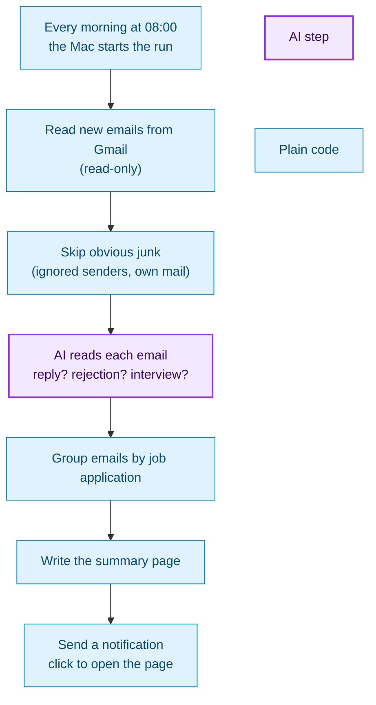

# email-digest-scheduler

A personal tool that runs on my Mac every morning. It reads my job-search Gmail inbox (read-only), sorts replies
to my job applications with a **small model running locally**, and writes a short "where do I stand" summary
to a local folder. No email content leaves the computer.

This repo only hosts the [homepage](https://movchaneric.github.io/email-digest-scheduler/) and
[privacy policy](https://movchaneric.github.io/email-digest-scheduler/privacy.html) that Google's OAuth consent screen requires.

## How a daily run works

Purple is the only AI step. Everything else is plain code.

## Where the AI is (and isn't)

| Step | Who does it |
|---|---|
| Deciding what each email is (reply / application sent / noise), its verdict, company and job title | **Local model** (qwen3:8b via Ollama), one call per email, answer forced into a fixed JSON shape |
| Starting the run, reading Gmail, skipping already-seen emails | Code (launchd + Gmail API, read-only) |
| Dropping Ignored Senders and self-sent mail | Code (rules, before the model is asked) |
| Grouping Replies into Applications, working out each Status, counting | Code (rules) |
| Writing the Digest and sending the notification | Code |

It is **not an autonomous agent**: the model never chooses tools or next steps and can't act on anything. The
code runs the same fixed pipeline every day and asks the model one narrow question per email. That keeps it
predictable, cheap to run and safe with a mailbox.
